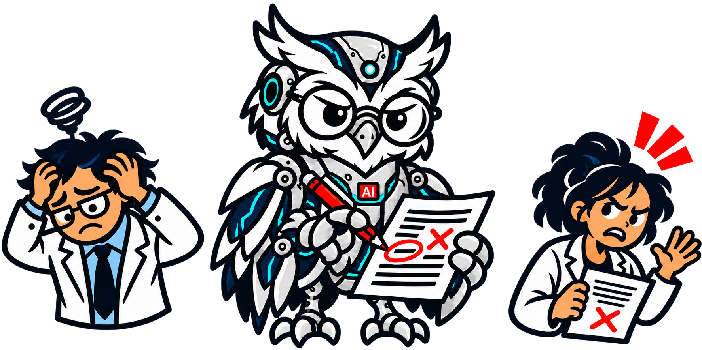
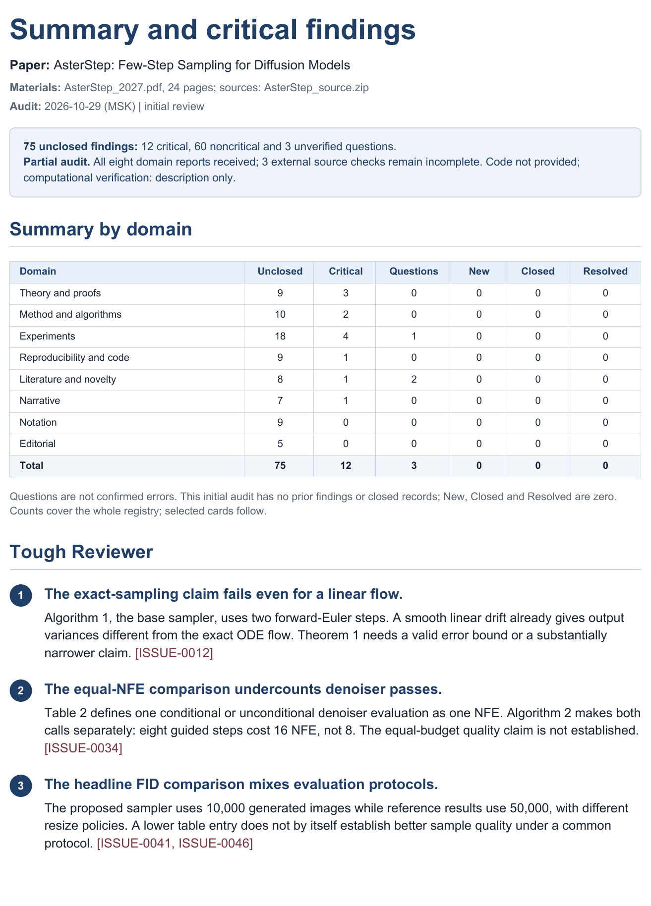
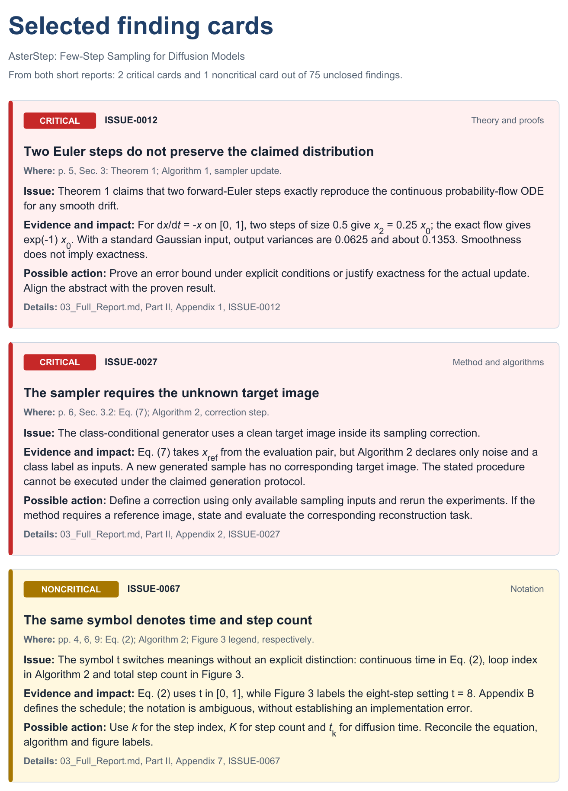

# Tough AI Paper Reviewer Prompt (1.0)

> “I should never have run the Tough AI Paper Reviewer. I was happier when I thought my paper was finished.”
>
> — An average researcher, probably

**Tough AI Paper Reviewer** is a prompt for agent-capable AI systems such as ChatGPT and Claude Code. It is designed for authors to stress-test their own papers before submission or final release, not to review other researchers' work. It focuses on top-tier computer science conferences (ICLR, ICML, NeurIPS, etc.), but its checks can also be used in other fields. It produces a detailed issue report and suggestions for revision, rather than a formal peer-review verdict.

With these instructions loaded, upload your paper to a chat and ask the assistant to find issues. A PDF is enough; you can also include source files, appendices, code, data, logs, or previous reviews. The assistant handles the meta-agent and eight subagents, reconciles their findings, and assembles one consistent report highlighting what needs attention. It searches online for papers and other sources, checks citations, and compares the submission with prior work.

<table align="center">
  <thead>
    <tr><th>Sub Agent</th><th>Main responsibility</th></tr>
  </thead>
  <tbody>
    <tr><td><strong>Theory</strong></td><td>Mathematical claims, assumptions, and proofs</td></tr>
    <tr><td><strong>Algorithms</strong></td><td>Method specification, derivations, and pseudocode</td></tr>
    <tr><td><strong>Practice</strong></td><td>Experiments, baselines, metrics, and numerical comparisons</td></tr>
    <tr><td><strong>Reproducibility</strong></td><td>Protocol details, code, hardware, and compute costs</td></tr>
    <tr><td><strong>Literature</strong></td><td>References, novelty, and significance</td></tr>
    <tr><td><strong>Narrative</strong></td><td>Abstract, introduction, background, and clarity of exposition</td></tr>
    <tr><td><strong>Notation</strong></td><td>Symbols and consistency across text, tables, and figures</td></tr>
    <tr><td><strong>Editorial</strong></td><td>Language, presentation, anonymity, and venue requirements</td></tr>
  </tbody>
</table>

Created by [Alexander Korotin](https://akorotin.netlify.app) with the help of AI assistants.

## Run a review

Use an AI agent system with subagents and web access, such as one powered by GPT or Claude. Upload the instruction ZIP or link this repository if accessible. Upload your paper and ask it to find issues using the [meta-agent instructions](meta_agent.md). Include conference details if known. To rerun, provide the revised paper and previous report; the system updates findings and marks verified fixes and new issues. Reports are in English by default; for another language, say, for example, “Write the review in Russian” in your prompt.

The author recommends **Claude Opus 5.5 (High)** or **GPT-6.1 Sol (High)**. In the author's experience, reviewing a typical computer science paper takes **1–4 hours** and uses roughly **5–20%** (usually **5–10%**) of a Claude 20× subscription allowance, or **5–15%** of a ChatGPT 5× allowance. These are rough usage estimates, not fixed limits; paper length, appendices, code, and service quotas affect them. Optimizing token usage is a direction for future work.

AI can hallucinate and make mistakes. In the author's experience, this approach finds a large share of genuine paper issues (high recall), with few false positives. However, many findings concern minor points that authors may reasonably choose not to address. Verify each finding against the paper and cited sources before revising the manuscript.

## Results

- `01_Summary_Critical.pdf` — overview, a skeptical reviewer's objections, and critical findings.
- `02_Noncritical.pdf` — noncritical findings.
- `03_Full_Report.md` — the complete, self-contained review: all findings, questions, verified fixes, evidence, and detailed analyses from all eight agents. Use it as a revision guide.

🔴 **Red**: critical open issues; 🟡 **Yellow**: noncritical open issues; 🟢 **Green**: verified fixes; 🟠 **Orange**: new findings on a rerun, with severity stated separately. Markdown sources, JSON registers, and audit records are retained. The full report stays in Markdown; only the two short reports become PDFs.

## Example output

Selected extracts from a synthetic audit of a fictional paper: the summary on the left and cards from both the critical and noncritical reports on the right. All findings and counts are illustrative. Click an image to view it at full size.

<table align="center">
  <thead>
    <tr><th>Summary and Tough Reviewer</th><th>Selected finding cards</th></tr>
  </thead>
  <tbody>
    <tr>
      <td width="50%" valign="top"></td>
      <td width="50%" valign="top"></td>
    </tr>
  </tbody>
</table>

## License

This project is licensed under [CC BY-NC 4.0](LICENSE).
